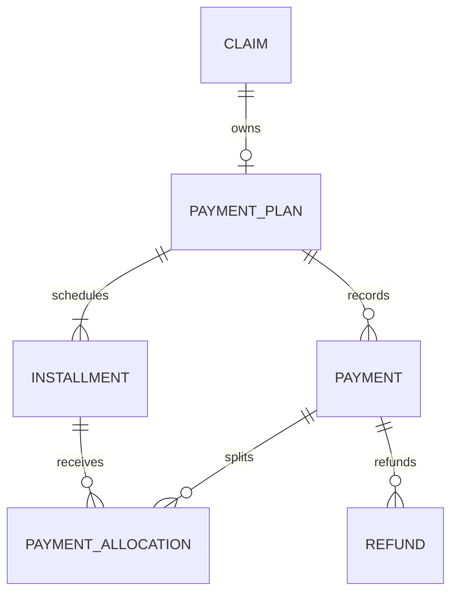

# Architecture

## Purpose and scope

The service manages one claim at a time and the payment plan attached to it. It supports:

- seeding a claim for a demo or test;
- creating one payment plan for a claim;
- reading the plan and its installments;
- recording payments and allocating them to installments;
- recording refunds against a payment's unallocated credit;
- reading payment and refund history;
- computing the plan status on read.

It is a case-study implementation. The rules are deliberate and tested, but the runtime
environment is a demo environment.

## System context

The claim is local to this service. There is no upstream claim system and no separate customer
or debtor service.

```text
client
  |
  | REST/JSON
  v
rate payment service  ---> H2 in-memory database
  ^
  |
  +--- demo claim seed (POST /api/claims)
```

The service owns the claim aggregate. A claim must exist before a payment plan can be created.
Claims enter through the demo seed endpoint only. There is no claim list, no claim update and no
claim deletion.

The API is claim-keyed. A plan has no public plan id because a claim has at most one plan.

## Runtime shape

| Item | Value |
| --- | --- |
| Language | Java 21 |
| Framework | Spring Boot 4.1.3 |
| Build | Maven, through the Maven wrapper |
| API | REST/JSON |
| Database | H2 in-memory |
| Schema | generated from the JPA entities |
| Time zone | `Europe/Berlin`, through one `Clock` bean |

The application class is `net.snobo.Application`. Every component is below `net.snobo`, so
Spring component and entity scanning find it.

## Package map

| Package | Responsibility |
| --- | --- |
| `net.snobo.config` | The `Clock` bean and other application configuration. |
| `net.snobo.db.entity` | JPA entities and their domain behaviour: `Claim`, `PaymentPlan`, `Installment`, `Payment`, `PaymentAllocation`, `Refund`. |
| `net.snobo.db.repository` | Spring Data repositories and locked or entity-graph queries. |
| `net.snobo.domain` | Value rules that do not need persistence: `Money`, `ClaimNumbers`, `InstallmentSchedule`, `ScheduledInstallment`, `Status`. |
| `net.snobo.rest` | `ClaimManagementController`, `ApiExceptionHandler` and the response/request records. |
| `net.snobo.service` | Transaction boundaries, orchestration and service exceptions. |

The controller does not expose entities. The services map entities to response records.

## Domain model



The relation direction matters. `Claim` owns the foreign key `claims.payment_plan_id`, which is
unique. `PaymentPlan.claim` is the inverse side. This enforces one plan per claim.

### Main entities

| Entity | Key fields | Rules |
| --- | --- | --- |
| `Claim` | `claimNumber`, `totalAmount`, `debtorName`, `createdOn`, `paymentPlan` | Claim number is positive, unique and at most 10 digits. Total is positive, precision 19, scale 2. Name and created date are required. |
| `PaymentPlan` | `claim`, ordered installments, ordered payments | Does not store a total, paid amount, outstanding balance or status. Those values are derived. |
| `Installment` | `installmentNumber`, `scheduledAmount`, `amountPaid`, `dueDate` | Number and scheduled amount are positive. Paid amount is between zero and the scheduled amount. Ordered by installment number. |
| `Payment` | `paymentId`, `amount`, `paidOn`, `recordedAt`, `reference`, allocations, refunds | Amount is positive, scale 2. Public id is a UUID. Reference is optional and unique per plan. |
| `PaymentAllocation` | `payment`, `installment`, `amount` | Amount is positive. One row per payment and installment. |
| `Refund` | `refundId`, `payment`, `amount`, `refundedOn`, `recordedAt`, `reference` | Amount is positive, scale 2. Reference is optional and unique per payment. |

### Database constraints

- `claims.claim_number`: not null, unique, positive, at most 10 digits.
- `claims.total_amount`: not null, positive, precision 19, scale 2.
- `claims.payment_plan_id`: unique foreign key. It is nullable because a claim can exist before
  its plan is created.
- `installments`: unique `(payment_plan_id, installment_number)`; scheduled amount positive;
  paid amount between zero and scheduled amount.
- `payments`: unique `(payment_plan_id, reference)` when the reference is not null; amount positive.
- `payment_allocations`: unique `(payment_id, installment_id)`; amount positive.
- `refunds`: unique `(payment_id, reference)` when the reference is not null; amount positive.

The database checks are a safety net. The entities validate the same rules first and throw
domain exceptions that the service maps to HTTP errors.

## Money

All money is `BigDecimal` with precision 19 and scale 2.

- `Money.normalize` uses `RoundingMode.UNNECESSARY`. A value that would need rounding is
  rejected. It is not silently changed.
- The API rejects a value that would need rounding to two decimals with `400`.
- There is no currency field. The service is single-currency for this case study.
- JSON carries money as a number. Tests pin the scale where the contract requires it.
- Sums are exact. Allocation subtracts from already-normalized values instead of dividing and
  rounding repeatedly.
- Installment splitting is the only place that divides. It uses `RoundingMode.DOWN` for the
  regular amount and puts the remainder on the last installment.

## Time and status

Business dates are `LocalDate`. The business time zone is `Europe/Berlin`, not a fixed `+01:00`
offset, so daylight saving time is handled.

Status is computed on read from the installments and the injected `Clock`:

| Condition | Status |
| --- | --- |
| Outstanding balance is zero | `COMPLETED` |
| At least one unpaid installment has `dueDate` before today | `OVERDUE` |
| Otherwise | `ACTIVE` |

Rules:

- `COMPLETED` wins over `OVERDUE`.
- Due today is not overdue. Overdue starts the day after the due date.
- A plan with no installments is invalid.
- Status is not stored and not queryable in SQL.
- Status can change between two reads without a database write. This is intended.
- A refund does not reopen a completed plan.

## Read model

The plan response is derived from the entity graph:

```text
totalClaimAmount    = claim.totalAmount
amountPaid          = sum(installment.amountPaid)
outstandingBalance  = sum(installment.scheduledAmount - installment.amountPaid)
creditAmount        = sum(payment.unallocatedAmount)
refundedAmount      = sum(refund.amount)
status              = plan.statusAt(clock)
```

For each payment:

```text
allocatedAmount     = sum(allocation.amount)
refundedAmount      = sum(refund.amount)
unallocatedAmount   = payment.amount - allocatedAmount - refundedAmount
```

These identities hold after every operation:

```text
amountPaid + outstandingBalance = totalClaimAmount
grossReceived = amountPaid + creditAmount + refundedAmount
currentlyHeld = amountPaid + creditAmount
```

`grossReceived` and `currentlyHeld` are explanations for integrators. They are not response
fields.

## Request and transaction flow

| Operation | Transaction behaviour |
| --- | --- |
| Read claim or plan | `@Transactional(readOnly = true)`. The claim lookup uses an entity graph for the plan and installments. |
| Seed claim | Read, validate, check for a duplicate, save and flush. A unique-constraint race maps to `409`. |
| Create plan | Read claim, reject an existing plan, build the schedule, link plan and installments, validate the sum, save and flush. A unique-constraint race maps to `409`. |
| Record payment | Load the claim with `PESSIMISTIC_WRITE`, load the plan, allocate, save the payment and flush. |
| Record refund | Load the claim with the same `PESSIMISTIC_WRITE` lock, load the payment, reject an over-refund, save the refund and flush. |
| History reads | `@Transactional(readOnly = true)`, ordered queries. |

Payments and refunds for one claim serialise on the claim row. That prevents two requests from
spending the same outstanding amount or the same credit. A lock failure maps to `409` with a
retry message.

## Error contract

All errors use `ProblemDetail` (RFC 9457) from one `@RestControllerAdvice`.

| Status | Meaning |
| --- | --- |
| `400` | Invalid claim number, body, field value, amount scale, date or installment request. |
| `404` | Unknown claim, plan or payment. |
| `405` | HTTP method not supported for the resource. |
| `409` | Duplicate claim, duplicate plan, duplicate reference, over-refund, insufficient credit or a lock/data conflict. |
| `415` | Unsupported content type. |
| `500` | Unexpected error. The body is generic; the stack trace is logged on the server. |

A `ProblemDetail` body contains `type`, `title`, `status`, `detail` and `instance`.

## Persistence and configuration

Main configuration (`src/main/resources/application.properties`):

- H2 in-memory database `jdbc:h2:mem:testdb`.
- `sa` / `password` demo credentials.
- `spring.jpa.properties.hibernate.hbm2ddl.halt_on_error=true`. A broken schema fails startup
  instead of being logged and ignored.

Test configuration (`src/test/resources/application-test.properties`):

- A unique H2 database name per context: `jdbc:h2:mem:${random.uuid}`.
- `ddl-auto=create-drop`.
- `spring.jpa.open-in-view=false`.
- `halt_on_error=true`.

There is no migration tool. The schema is generated from the entities. That is acceptable for
the case study and is not a production persistence strategy.

## Cross-cutting assumptions

- The claim is local. There is no upstream claim service.
- One plan per claim. There is no plan history.
- The claim owns the total. The plan does not keep a second copy.
- Claim numbers are `Long` values with at most 10 digits. The API shows a 10-digit zero-padded
  string and keeps the value numeric in storage.
- The service is single-currency.
- Deletions are out of scope.
- There is no customer aggregate and no claim list.
- Claims are seeded through the demo endpoint only.
- H2 is the demo database. No Testcontainers and no PostgreSQL.
- The ledger is append-only. Payments and refunds are not deleted or reversed.
- Idempotent replay is not implemented. References are duplicate guards, not replay keys.

## Key decisions and rejected alternatives

| Decision | Chosen rule | Alternative not used |
| --- | --- | --- |
| Claim ownership | Local `Claim` aggregate. | An external claim reference only. |
| Claim identity | Claim number is the API key; a plan has no public id. | Internal plan id in the path. |
| Plan cardinality | One plan per claim. | Plan history with `payment-plans/{planId}`. |
| Total ownership | The claim owns the total; the plan derives. | A second total on the plan. |
| Money type | `BigDecimal`, precision 19, scale 2. | `double` or integer minor units. |
| Rounding | Exact normalization; reject values that need rounding. | Silent `HALF_UP` rounding of input. |
| Time | `Europe/Berlin` through a `Clock` bean. | Fixed `+01:00` offset or the server default zone. |
| Status | Computed on read. | Stored status with a scheduled transition job. |
| Read model | Installments are the source of truth; totals and status are derived. | Stored paid and outstanding columns. |
| Payment audit | Append-only payment ledger plus allocation rows, with `installment.amountPaid` as a projection. | Only mutating the installment paid amount. |
| Overpayment | Spread to future installments, then keep as credit. | Reject overpayments with `409`. |
| Payment on a completed plan | Accept and record as credit. | Reject with `409`. |
| Refund scope | Refund only unallocated credit. | Reverse allocated payments and reopen the plan. |
| Concurrency | Pessimistic write lock on the claim. | Optimistic version plus retry. |
| Idempotency | Optional reference as a duplicate guard. | Idempotency key with replay of the original result. |
| Database | H2 in-memory with generated schema. | PostgreSQL and Testcontainers with migrations. |

## What a real deployment must add

The implementation is honest about its demo boundary. A production deployment would still need:

- an authenticated and authorised API;
- a persistent database and schema migrations;
- a real claim source or import instead of the demo seed endpoint;
- integration with a payment or bank feed, including an idempotency key and replay handling;
- a decision on multi-currency, interest, fees and accounting export;
- pagination for payment and refund history;
- observability, metrics and alerting for locked transactions and rejected requests;
- explicit `spring.jpa.open-in-view=false` in the main profile;
- tuned database lock timeouts and retry behaviour.
